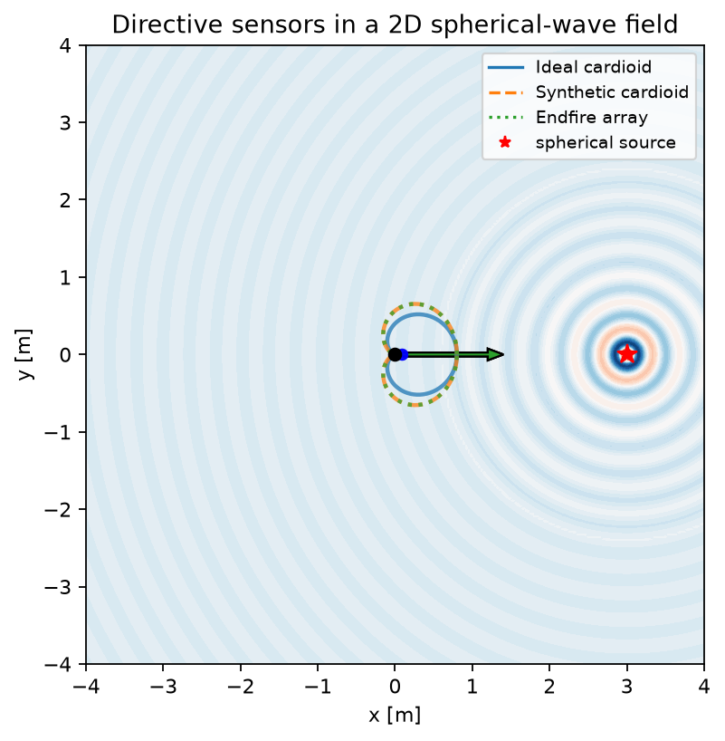

# endfire-sim

Simulation of acoustic waves, microphone directivity, and endfire arrays in space and time.
Sampled spherical-source propagation is **powered by [Acoular](https://acoular.org/)**.

<a href="https://acoular.org/"></a>

## Install

With pip from GitHub:

```bash
python -m pip install git+https://github.com/jake-is-ESD-protected/endfire-sim.git
```

With [uv](https://docs.astral.sh/uv/):

```bash
uv add git+https://github.com/jake-is-ESD-protected/endfire-sim.git
```

## Example

```python
import matplotlib.pyplot as plt
import numpy as np
from endfiresim.sensor import CCardioidIdeal, CCardioidSynthetic, CEndfire
from endfiresim.wave import CWaveModelSpheric

f, radius = 1_000, 3.0
sensors = {
    "Ideal cardioid": CCardioidIdeal((0, 0, 0), np.pi / 2, 0),
    "Synthetic cardioid": CCardioidSynthetic((0, 0, 0), target_freq=f, elev=np.pi / 2, azim=0),
    "Endfire array": CEndfire((0, 0, 0), target_freq=f, elev=np.pi / 2, azim=0),
}

x = y = np.linspace(-4, 4, 240)
xx, yy = np.meshgrid(x, y)
positions = np.stack((xx, yy, np.zeros_like(xx)))
wave = CWaveModelSpheric(f, source_xyz=(radius, 0, 0))

fig, ax = plt.subplots(figsize=(6, 5))
ax.contourf(xx, yy, np.real(wave.p(0, positions)), levels=40, cmap="RdBu_r")
colors = ["tab:blue", "tab:orange", "tab:green"]
styles = ["-", "--", ":"]
for (name, sensor), color, style in zip(sensors.items(), colors, styles):
    start = len(ax.lines)
    sensor.to_plot(ax, size=0.8, color=color)
    for line in ax.lines[start:]:
        line.set_alpha(0.75)
        line.set_linestyle(style)
ax.plot(radius, 0, "r*", markersize=10)
ax.set_aspect("equal")
plt.savefig("assets/spherical-cardioids.png", dpi=160, bbox_inches="tight")
plt.show()
```

**Output:**



## Development

```bash
uv run pytest
```

Released under the GPL-3.0-only license.
